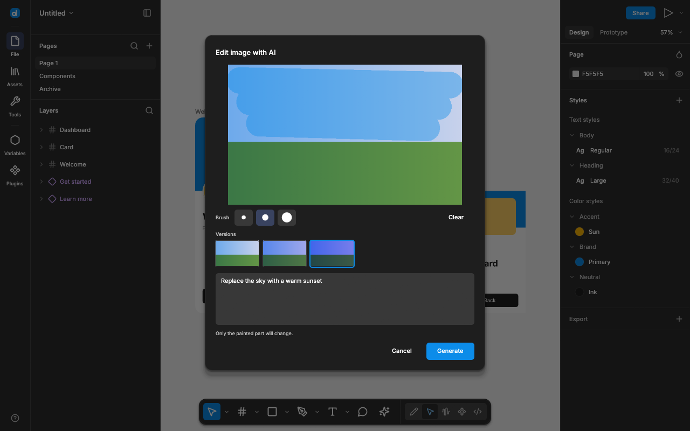

<h1 align="center">
  
</h1>

<p align="center">
  <b>界面设计：一款用 Rust 构建的独立、本地优先、开源的设计工具。</b><br>
  框架、自动布局、组件与变体、原型、<b>实时协作</b>、<b>关键帧动效</b>、白板、演示文稿、矢量编辑，<br>
  以及真正的 Figma 文件导入——全部在一个完全用 Rust 编写的原生桌面应用中。免费、离线，且可随心修改。
</p>

<p align="center">
  
  
  
  
  <a href="https://github.com/deepfounder-ai/desigma/actions/workflows/ci.yml"></a>
</p>

<br>

<p align="center">
  
  <br>
  <sub>内置于应用中的展示文件里运行的编辑器：四个 390 x 844 的屏幕，用自动布局和组件搭建，其中一个处于变量集合的深色模式。</sub>
</p>

<br>

<table>
  <tr>
    <td width="25%" valign="top">
      <h3>🎛️ 上手即熟悉</h3>
      熟悉的设计工作流与快捷键，从 <kbd>F</kbd> 新建框架到 <kbd>Shift</kbd>+<kbd>A</kbd> 自动布局。Desigma 正在打磨自己的编辑器界面，以文档还原度和流畅的编辑体验为首要目标。
    </td>
    <td width="25%" valign="top">
      <h3>⚡ 原生且迅速</h3>
      基于 tiny-skia 的确定性 CPU 渲染器、空间索引和并行 256&nbsp;px 瓦片缓存。在 5,000 图层页面上平移和拖拽依然远低于一帧耗时。没有 Electron，没有 WebView。
    </td>
    <td width="25%" valign="top">
      <h3>🗂️ Figma 文件导入</h3>
      支持从 Figma REST API JSON 导入，也可直接打开 <code>.fig</code> 文件（kiwi 容器，deflate 或 zstd 压缩），并保留组件、实例覆盖、样式和原型链接。
    </td>
    <td width="25%" valign="top">
      <h3>🔤 内置开源字体</h3>
      Inter 字体直接随二进制打包。文件用到的其他开源授权字体族会从 Fontsource 拉取并缓存，专有字体则映射到度量兼容的开源替代字体。
    </td>
  </tr>
</table>

<p align="center">
  <a href="#live-collaboration-beta"><b>👥 新功能：实时协作</b></a> 分享一个链接，一起编辑，无需账号 &nbsp;·&nbsp;
  <a href="#motion-beta"><b>🎬 动效</b></a> 关键帧、弹簧、41 种预设以及 GIF/WebM 导出 &nbsp;·&nbsp;
  <a href="#download">下载</a> &nbsp;·&nbsp; <a href="#build-from-source">从源码构建</a>
</p>

<br>

## 功能特性

### Desigma 演示文稿

通过 **File → New deck** 创建演示文稿。Decks 使用可编辑的 16:9 框架，带有幻灯片缩略图、新增/复制/删除控件、排序、总览和演讲者备注。切换到 **Layers** 即可使用现有的文本、形状、图片和矢量编辑工具。备注通过 **Save notes** 保存，或在切换到其他幻灯片时自动保存。幻灯片编辑和已保存的备注支持撤销/重做，并持久保存在文档中。

**Present** 从当前活动幻灯片开始播放。使用 Right/Space/Page Down 和 Left/Page Up，或 Previous/Next；Home/End 跳转到第一张/最后一张幻灯片。点击 **Fullscreen** 或按 **F11** 进入隐藏控件的无边框演示；**Esc** 先回到预览，再退出。可用 `--fixture deck --fullscreen` 直接启动演示。本初始版本尚不包含转场动画、模板库或独立的演讲者显示器。可用 `cargo run -p desigma-app -- --fixture deck` 预览示例。

使用 **Slide PDF** / **Deck PDF** 控件或 File 菜单导出当前幻灯片或整套演示文稿。每张幻灯片按文档顺序成为 PDF 的一页，不含演讲者备注和编辑器控件。初始的 PDF 导出采用高分辨率栅格页面；文字不可选中。

此处的每张截图都是真实应用在内置展示文件上的效果，通过其自带的 <code>--screenshot</code> 模式以 2x 离屏捕获。

<table>
  <tr>
    <td width="50%" valign="top">
      
      <br>
      <sub>一个 Button 实例：变体选择器（Type、Size）、文本属性、布尔属性，以及这一副本上的覆盖项。</sub>
      <h3>始终同步的组件</h3>
      用 <kbd>Ctrl</kbd>+<kbd>Alt</kbd>+<kbd>K</kbd> 把任意图层变成组件，从 Assets 面板拖出实例，再编辑主组件：所有实例都会在同一次撤销步骤中更新，同时保留各自的覆盖项。
      <br><br>
      <b>布尔、文本、变体和实例交换属性</b>、组合为变体、前往主组件、重置所有更改和分离，全部可撤销。
    </td>
    <td width="50%" valign="top">
      
      <br>
      <sub>原型模式：流程起点，以及从所选屏幕连向其按钮目标的连接线。</sub>
      <h3>画什么就能演示什么</h3>
      从图层的热区拖到某个框架完成连线，然后细化交互：触发器、动作、覆盖层和带缓动曲线与弹簧的转场。
      <br><br>
      <b>Present</b> 可以播放这些交互，支持 Navigate、Back、覆盖层、Change to（变体）、Scroll to 和 Smart Animate——后者按名称配对图层并进行插值。**变量驱动一切**：Set variable（附带一个小型安全表达式语言）、Set variable mode 和 Conditional（If / Else if / Else）会实时重新渲染绑定的文本、颜色和可见性，且绝不会改动文件本身。按键、游戏手柄和拖拽触发器、交互组件（悬停与按下状态并自动还原）以及视频填充（Motion JPEG 在纯 Rust 构建中即可播放，其他编解码器显示封面帧；`cargo build -p desigma-app --features video` 可通过 OpenH264 增加 H.264，它会编译 C++）均已包含。
    </td>
  </tr>
  <tr>
    <td width="50%" valign="top">
      
      <br>
      <sub>Variables 视图：一个 Theme 集合，包含 Light 和 Dark 模式、指向基础变量的别名以及数值变量。</sub>
      <h3>变量与模式</h3>
      集合中的颜色、数值、字符串和布尔变量带有多种模式，通过字段旁的选择器绑定到填充、描边、尺寸和间距。把一个框架切换到另一个模式，所有绑定到它的内容都会随之改变。
      <br><br>
      <b>库变量</b>和颜色样式会出现在相同的选择器中；使用一项会在同一次撤销步骤中把它复制进当前文件。
    </td>
    <td width="50%" valign="top">
      
      <br>
      <sub>Dev 模式：所选卡片的状态、标注、测量结果和 SwiftUI 代码。</sub>
      <h3>以代码的形式交付</h3>
      切换到 Dev 模式即可查看测量结果、盒模型，以及生成的 CSS、Tailwind、SwiftUI、Jetpack Compose 或 React 代码。把框架标记为 Ready for dev，并为实现者添加标注和链接。
      <br><br>
      一键<b>复制</b>代码片段，或在面板内直接切换语言。
    </td>
  </tr>
  <tr>
    <td width="50%" valign="top">
      
      <br>
      <sub>一个 1440 px 的仪表盘：侧边栏、KPI 卡片、图表和表格，全部由自动布局和组件实例构成。</sub>
      <h3>真实布局，不只是矩形</h3>
      嵌套的自动布局框架支持 hug、fill 和固定尺寸、内边距、间距和对齐，当文案变化时仍能让整个仪表盘保持形状。图表就是普通的矢量、矩形和弧形。
      <br><br>
      表格和页眉中的 <b>Tag、Avatar 和 Button 实例</b>来自与移动端屏幕相同的组件集。
    </td>
    <td width="50%" valign="top">
      
      <br>
      <sub>渐变填充上的取色器，下方列出页面中用到的颜色。</sub>
      <h3>填充、渐变与效果</h3>
      纯色、线性、径向、角度和菱形渐变、图片和混合模式可用于每一种填充，渐变停点可以直接在图层上拖拽。共享的颜色样式和变量也出现在同一个选择器中。
      <br><br>
      <b>效果</b>包括外阴影和内阴影、图层与背景模糊、噪点、纹理和玻璃。
    </td>
  </tr>
  <tr>
    <td width="50%" valign="top">
      
      <br>
      <sub>项目主页：一个 Marlow 项目，包含白板、设计系统、仪表盘和应用。</sub>
      <h3>你的文件，集中管理</h3>
      本地项目库带有最近使用、星标、项目和文件夹、搜索、网格与列表视图、缩略图、回收站和拖放。文件在你工作时自动保存，"Open in new window" 会在同一库上再开一个编辑器。
      <br><br>
      <b>共享库</b>会把一个文件的组件、样式和变量发布出去供其他文件启用，新版本到达时带有审阅环节。
    </td>
    <td width="50%" valign="top">
      
      <br>
      <sub>一块白板：便签、连接线、带文字的形状、图章和一个分区。</sub>
      <h3>用于即兴思考的白板</h3>
      在 File 菜单或主页新建 board，会打开一块带独立工具栏的白板：文字自动缩放以适配的便签（宽便签和作者标签同样如此）、带文字的形状、包含马克笔（<kbd>M</kbd>）、荧光笔、和纸胶带和橡皮的绘图托盘、带语法高亮的代码块、图章、能带着其中便签一起移动的彩色分区（<kbd>Shift</kbd>+<kbd>S</kbd>），以及带 + 手柄和 <kbd>Tab</kbd> 单元格切换的表格（<kbd>Shift</kbd>+<kbd>T</kbd>）。<kbd>Tab</kbd> 会开始下一张便签，<kbd>Alt</kbd>-拖拽可复制。顶栏还提供计时器和投票会话。
      <br><br>
      <b>连接线</b>从任意形状的磁吸点出发，绕开它们所连接的方框，并随方框移动而跟随。FigJam 文件可以作为白板打开。
    </td>
  </tr>
  <tr>
    <td width="50%" valign="top">
      
      <br>
      <sub>渲染器功能测试表，由 <code>cargo run -p desigma-render --example render_demo</code> 生成。</sub>
      <h3>在像素上下功夫的渲染器</h3>
      独立的圆角半径和 iOS 风格圆角平滑、每一种渐变类型、图片填充、内/中/外描边、外阴影和内阴影、图层与背景模糊、蒙版和布尔运算。
      <br><br>
      <b>全部 19 种混合模式</b>，包括精确的 linear burn 和 linear dodge；文字用 cosmic-text 进行整形，支持文本段（runs）、行高、字距、大小写转换和截断。
    </td>
    <td width="50%" valign="top">
      
      <br>
      <sub>Actions（<kbd>Ctrl</kbd>+<kbd>K</kbd>）：所有命令皆可搜索，并附带快捷键。</sub>
      <h3>一切都在一次按键之间</h3>
      主菜单、工具下拉、右键菜单和命令面板共用同一个一致的菜单组件，支持完整的键盘导航和子菜单。
      <br><br>
      <b>导出</b>为 PNG、JPG 和真正的矢量 SVG（任意倍率），可复制为 PNG、SVG 或 CSS，还可以切换到 Dev 模式获取测量结果和可直接粘贴的 CSS。
    </td>
  </tr>
</table>

<br>

## 动效（beta）

动效模式（工具栏上的波形按钮）把一个页面变成时间线。它和应用的其他部分一样免费，并且完全离线可用。

<p align="center">
  
</p>

<table>
  <tr>
    <td width="50%" valign="top">
      
      <br>
      <sub>画布下方的时间线，右侧是 Motion 检查器。此文件已内置：<code>cargo run -p desigma-app -- --motion</code>。</sub>
    </td>
    <td width="50%" valign="top">
      
      <br>
      <sub>缓动编辑器：每一段都可以设置曲线、定格和弹簧。</sub>
    </td>
  </tr>
  <tr>
    <td width="50%" valign="top">
      
      <br>
      <sub>预设库：Basic、Enter、Cycle 和 Exit 共 41 种预设。</sub>
    </td>
    <td width="50%" valign="top">
      
      <br>
      <sub>每个预设都是可编辑的剪辑：方向、幅度、延迟、时长、缓动、重复和 yoyo。</sub>
    </td>
  </tr>
</table>

其中包含：

- 每页一条 **时间线**：时长、fps 和循环，可拖动擦洗的播放头、带属性轨道的图层行、可拖拽/拉伸/复制的关键帧菱形、自动关键帧，以及对齐到框架和关键帧的吸附。
- **关键帧**可用于位置、缩放、旋转、宽度、高度、不透明度、圆角半径、填充和描边颜色、描边粗细、投影（偏移、模糊、颜色）和图层模糊，Motion 检查器中每个字段旁都有 ◇ 标记，画布上有运动路径和操纵柄，每条轨道可单独控制可见性，每个图层还有可拖拽的摘要条。
- **缓动**：定格、线性、ease in/out、back 曲线、自定义 cubic-bezier，以及基于时长的弹簧（Gentle、Quick、Bouncy、Slow 或自定义回弹）。每一段都有独立的缓动。
- **41 种预设**（Basic、Enter、Cycle、Exit），会变成可重新计时和微调的**剪辑**；循环预设会重复或 yoyo，直到时间线结束。
- **Present 播放**：框架在到达时播放自己的时间线，同时原型继续工作。框架之间的 Smart Animate 仍然有效，到达目标框架时会播放其动画。
- **原型动作**：*Control animation*（Play、Play from start、Pause、Restart、Toggle）可搭配任意触发器：On click、While hovering（离开时还原）、While pressing、After delay、按键。带此类动作的框架会等待被播放；其他动画框架则自动播放。目标可以是框架或其中的任意图层（会解析到框架）。
- **导出**页面或框架为动画 **GIF**、**WebM**（AV1，纯 Rust 编码）或 **PNG** 序列（文件夹或 zip），fps 和倍率任意，可从时间线、检查器的 Animation 区或命令行发起。
- **Figma Motion 导入**：来自 Figma Motion 模式制作的 `.fig` 文件的关键帧轨道、曲线与弹簧缓动以及预设剪辑，会作为可编辑的 desigma 动效导入。曲线运动路径和颜色/效果轨道暂不支持导入。
- **代码**：Dev 模式可以把所选图层的动画转换为 CSS keyframes、SwiftUI 或 Jetpack Compose。
- **MCP 工具**（`desigma_add_keyframe`、`desigma_apply_animation_preset`、`desigma_set_timeline`、`desigma_export_animation`），让智能体也能驱动动画并渲染。

```sh
cargo run -p desigma-app -- --motion                         # the built-in animated onboarding, in Motion mode
cargo run -p desigma-app -- --motion --screenshot docs/images/desigma-motion.png --scale 2
cargo run -p desigma-app -- --motion --panel motion-easing --screenshot easing.png --scale 2
cargo run -p desigma-app -- --export-animation onboarding.desigma --out onboarding.gif --scale 0.75 --fps 20          # add --dither to smooth gradients (bigger file)
```

动效遵循 Figma 的 Motion (Beta) 模式的工作流，但这是 desigma 自己的实现，与 Figma, Inc. 无任何隶属关系。动画数据保存在 `.desigma` 文件以及 desigma 的 REST JSON 导出中；无法写回 `.fig` 文件。

## AI 图片（beta）

不离开画布即可生成图片，或重生成图片的一部分。desigma 没有自己的 AI 服务：它使用**你自己的 [OpenRouter](https://openrouter.ai) 密钥**和你选择的图像模型，费用由你承担。



- **Preferences → AI images…**：粘贴你的 OpenRouter API 密钥，并从 OpenRouter 列表中选择模型。密钥保存在系统钥匙串中（Windows Credential Manager、macOS Keychain、Linux 上的 Secret Service），绝不会写入文件或文档。
- **Generate image…**（Object 菜单或右键）：描述图片内容并选择比例。选中的图层会作为参考图发送；选中的空矩形、椭圆或框架会被生成结果填充。
- **Edit image with AI…**：选中带图片填充的图层，用画笔涂抹要修改的部分，然后描述应该怎么改。只有你涂抹的区域会取自模型的结果，其余部分逐像素保持不变。什么都不涂抹时则重生成整张图。
- **版本**：每次生成都会连同提示词一起记录在其图层上，并保存进文件。点击对话框中较早的图片即可找回。
- 请求进行中，图片即将出现的位置会在画布上发光。一次生成就是一个撤销步骤。

你的提示词和参考图会发送给 OpenRouter 及模型提供方；在你按下 **Generate** 之前不会发送任何内容。详情见 [docs/ai-images.md](docs/ai-images.md)。

## 实时协作（beta）

在编辑器中点击 **Share**，复制 `desigma://join/…` 链接并发送。任何拿到链接的人都可以打开它（或粘贴到主界面的 **Join session**），与你实时编辑同一个文件，Windows、macOS 或 Linux 均可。没有账号，也没有服务器：你的 desigma 副本在文件保持打开期间承载这个会话。

- **点对点且加密**，基于 [iroh](https://github.com/n0-computer/iroh) QUIC 并带 NAT 穿透；当直连不可行时，流量会经过公共中继，依然是端到端加密。
- **按属性合并编辑**：两个人修改同一图层的颜色和位置，各自的修改都会保留；向同一框架插入内容都会存活；删除优先于编辑。拖拽会实时显示。
- **你的撤销只撤销你自己的编辑。**
- **光标、选区和头像**都使用每个人的颜色；点击头像即可 **Follow** 对方的视图。
- **可选密码、逐个批准加入者、可编辑或只读权限、踢出、停止共享。**
- 宿主关闭文件时会话结束；访客可以保存副本。字体暂不随会话发送。desigma 已在运行时点击链接会在该窗口中打开（macOS 上通过 Apple events，其他平台上由第二次启动移交）；粘贴到 Join session 也始终可用。

设计与协议：[docs/collaboration.md](docs/collaboration.md)。

## 功能全景

<table>
  <tr>
    <td width="33%" valign="top">
      <h4>🧰 工具</h4>
      移动 · 抓手 · 框架 · 分区 · 切片 · 矩形 · 直线 · 箭头 · 椭圆 · 多边形 · 星形 · 图片 · 钢笔 · 铅笔 · 文本，配有吸附、智能参考线和距离标注、多选、旋转、alt 拖拽复制和矢量网络：支持弯曲的点编辑、油漆桶、框选和套索选择、逐顶点圆角、端点与手柄镜像，还有形状生成器、轮廓化描边、扁平化、简化、连接与分割。
    </td>
    <td width="33%" valign="top">
      <h4>📐 布局</h4>
      自动布局支持方向、换行、间距、内边距、对齐以及 hug、fill 或固定尺寸，还支持拖拽排序。约束、分组、裁剪框架，以及可新增、复制、排序和删除的页面。
    </td>
    <td width="33%" valign="top">
      <h4>🎨 样式与颜色</h4>
      带名称、文件夹和键的共享颜色、文本和效果样式，一键应用。Selection colors 区可以一次编辑某颜色的所有使用处。
    </td>
  </tr>
  <tr>
    <td width="33%" valign="top">
      <h4>🗂️ 格式</h4>
      输入：<code>.fig</code>（包括 FigJam 白板和 Motion 数据）、Figma REST JSON、Pencil <code>.pen</code>、SVG 和原生 <code>.desigma</code>。输出：<code>.desigma</code>、Figma REST JSON、PNG、JPG、SVG、PDF，以及动画 GIF、WebM 和 PNG 序列。图片支持 PNG、JPEG 和 WebP。
    </td>
    <td width="33%" valign="top">
      <h4>🔤 文字排版</h4>
      内置 Inter 可变字体、按文本段的样式、以像素或百分比表示的行高、字距与段距、大小写转换、装饰线、自动调整大小和带省略号的截断。
    </td>
    <td width="33%" valign="top">
      <h4>🪄 日常必备</h4>
      每一次编辑都可撤销与重做、复制粘贴、成组与解组、对齐与分布、层级顺序、翻转与 90° 旋转，以及缩放至适配或 100%。
    </td>
  </tr>
</table>

<br>

## Figma 文件

desigma 读取两类 Figma 输入，两者都汇入同一个文档模型：

- **REST JSON**，即 `GET /v1/files/:key` 的响应体。把它保存成文件后打开，或者让 `desigma-fig` 的可选 `net` 特性用你的个人访问令牌去拉取。令牌只会作为请求头发送，绝不会被记录或存储。
- **`.fig` 文件**，来自 *File → Save local copy*。desigma 解开 zip 包装，解码 kiwi schema 与消息，并映射节点变更、内嵌图片、共享样式、实例覆盖、布局网格和原型交互。

`.fig` 格式没有官方文档。我们的解码器基于社区逆向工程实现，并使用合成文件进行测试，因此遇到真实文件时可能会有缺口，欢迎报告。

### Pencil 文件

`.pen` 文件（[Pencil](https://docs.pencil.dev/for-developers/the-pen-format) 设计工具的纯 JSON 格式）也可以打开，途径包括 *File → Open*、拖放、项目主页或 `desigma file.pen`。框架和自动布局、形状、路径、文本、填充、描边、效果、带实例覆盖的组件，以及带主题的变量都能迁移过来；脚本、着色器和图标库图标则不能，打开时的 toast 会列出被舍弃的内容（[字段映射](crates/desigma-pen/FIELDS.md)）。与 `.fig` 一样，导入的 `.pen` 不会被写回：Save 保存为 `.desigma`。这只是文件兼容；desigma 与 Pencil 无隶属关系，也未获其认可。

## 底层实现

- **一个文档模型：** `desigma-doc` 就是纯数据加一个撤销栈。每次编辑都是一个带有精确逆操作的 `Command`。
- **确定性渲染：** `desigma-render` 在 CPU 上用 tiny-skia 绘制，因此输出可以逐字节复现。拼接起来的瓦片与整页渲染结果完全一致。
- **视觉回归工具：** `desigma-diff` 比较截图，带抗锯齿检测和 SSIM，并输出 HTML 报告。开发目标是忠实的文档还原和一个独立设计的编辑器，拥有自己的已批准 UI 基线。
- **独立的产品方向：** 文件兼容与熟悉的工作流指导开发；复刻 Figma 编辑器外观不是目标。第三方代码、字体和素材保留各自的许可与署名要求。
- **充分测试：** 工作区拥有超过 1,600 个测试，从撤销和导入往返到用合成输入驱动编辑器的 UI 测试。

| Crate | 作用 |
|---|---|
| `desigma-doc` | 场景图、填充、文本、自动布局、组件、原型与动效模型（关键帧、缓动、弹簧、预设）、撤销/重做 |
| `desigma-engine` | 应用与 MCP 服务器共享的编辑逻辑：事务、自动布局、文本测量、组件同步 |
| `desigma-render` | tiny-skia 渲染器、空间索引、并行瓦片缓存 |
| `desigma-gpu` | 带 CPU 回退的 wgpu 渲染器 |
| `desigma-svg` | SVG 导入 |
| `desigma-pen` | Pencil `.pen` 导入 |
| `desigma-library` | 项目、团队库、发布与版本历史 |
| `desigma-fig` | Figma REST JSON 与 `.fig` 导入、REST JSON 导出 |
| `desigma-fonts` | 内置 Inter、Fontsource 拉取与缓存、字体替换 |
| `desigma-export` | PNG、JPG、SVG 和 PDF 导出、动画 GIF / WebM / PNG 序列、Dev 模式 CSS、SwiftUI 与 Compose 代码 |
| `desigma-collab` | 实时协作同步：文档 diff、宿主排序、冲突规则、按人撤销 |
| `desigma-net` | 基于 iroh 的点对点会话传输：链接、密码、批准、在线状态 |
| `desigma-app` | egui 桌面编辑器 |
| `desigma-diff` | 像素 diff 库与 CLI |
| `desigma-mcp` | 用于设计文件检查、编辑和代码生成的本地 MCP 服务器 |

## 快速开始

### 下载

从[最新发布页](https://github.com/deepfounder-ai/desigma/releases)获取你所在平台的构建包：macOS 的 `.dmg`（Apple Silicon 与 Intel 共用一个文件）、Windows 的 `-setup.exe` 安装器（或便携版 `.zip`），以及 Linux 的带安装脚本的 `.tar.gz`。

> [!NOTE]
> 发布构建**尚未进行代码签名**，因此首次启动会出现警告。在 **Windows** 上，运行安装器并在 SmartScreen 对话框中点击 **More info → Run anyway**。在 **macOS** 上，打开 `.dmg`，把 desigma 拖入 Applications，打开一次，然后在 **System Settings → Privacy & Security** 中点击 **Open Anyway**，或运行 `xattr -dr com.apple.quarantine /Applications/desigma.app`。分步说明：[docs/install.md](docs/install.md)。

### 从源码构建

```sh
git clone https://github.com/deepfounder-ai/desigma
cd desigma
cargo run --release -p desigma-app               # the editor, with a demo document
cargo run --release -p desigma-app -- file.fig   # open a Figma file
cargo test --workspace                           # the test suite
```

在 Linux 上你需要常规的窗口系统头文件：`pkg-config libxkbcommon-dev libwayland-dev libx11-dev libxcursor-dev libxrandr-dev libxi-dev libgl1-mesa-dev libfontconfig1-dev`。macOS 在 CI 中完成构建与测试。

想参与贡献或发布版本？见 [CONTRIBUTING.md](CONTRIBUTING.md) 和 [docs/releasing.md](docs/releasing.md)。

用于自动化和测试的实用标志：

```sh
desigma --screenshot out.png --size 1600x1000 --select Card   # render one frame and exit
desigma --fixture showcase --select Home --size 1600x1000 --scale 2 --screenshot hero.png   # the showcase file, rendered at 2x (3200x2000)
desigma --select Welcome --rulers --layout-grid columns --zoom 120 --screenshot out.png   # rulers + column grid
desigma --edit-text "Welcome back" --select-text 0-7 --screenshot out.png                 # mid-edit with a selection
desigma --tab prototype --present                              # open straight into Present
desigma --fixture proto-vars --select Add --tab prototype --panel interaction --screenshot i.png   # the interaction editor with a Conditional
desigma --fixture proto-vars --present --panel present-variables --screenshot p.png                # Present with the live Variables panel
desigma --seed-library ./my-library                            # fill a library directory with the showcase sample files
desigma --home --library ./my-library --screenshot home.png    # the projects home screen on a library directory
desigma --fixture variables --panel variables --screenshot v.png  # the Variables view
desigma-diff compare reference.png actual.png --out diff.png   # pixel-compare two images
```

> [!IMPORTANT]
> **状态：** desigma 处于早期 alpha。Figma 日常设计面的大部分能力已经具备，但**尚不能替代专业日常设计工作**。最大的缺口是协作、插件、PDF 导出、真实文件尚未覆盖的 `.fig` 特性，以及代码签名的发布构建。请包容粗糙之处，并在提交 issue 时附上你的操作系统、可以分享的示例文件和截图。

## MCP 集成

用 `cargo build --locked -p desigma-mcp` 构建本地服务器，然后把你的 MCP 客户端配置为启动 `desigma-mcp --workspace /path/to/designs`。它提供 32 个工具，用于导入文件、检查图层与 token、生成代码、带撤销/重做的编辑（图层、页面、组件与实例、动效），以及保存 `.desigma` 文件。当编辑器的智能体桥开启时（Preferences → **Allow MCP agents to control this editor**，或以 `desigma --bridge` 启动），同样的工具会编辑屏幕上打开的文档并共享其撤销栈；桥开启期间会显示一个状态胶囊。没有运行中的编辑器时，服务器照旧在隔离的文件会话上工作。见[安装与工具参考](crates/desigma-mcp/README.md)，以及[智能体如何驱动它](docs/agent-workflows.md)——包含工作区约定、何时应生成代码而非读取节点树，以及一个示例文档。

## 原生插件安装

从编辑器侧栏或主菜单打开 **Plugins**，选择 **Install plugin**，然后粘贴来自 [desigma-plugins](https://github.com/deepfounder-ai/desigma-plugins) 的 manifest URL。支持 GitHub `blob` 和 raw URL，例如：

```text
https://github.com/deepfounder-ai/desigma-plugins/blob/main/plugins/icon-browser/manifest.json
```

注册表是公开的，因此不需要 token。安装器使用 GitHub contents API，该 API 允许每小时 60 次未认证请求；如果触及限制，请在启动编辑器前把 `DESIGMA_PLUGINS_TOKEN` 设为任意 GitHub token。安装器不会自动发现凭据，也绝不会把凭据放进 URL 或安装元数据中。建议用 commit SHA 代替 `main` 以固定包版本。

Schema 2 插件包含一个根 HTML 面板和声明的 HTML/CSS/JavaScript 资源。在已安装插件上选择 **Open**，即可在浏览器中启动其面板。Icon Browser 可以把静态 SVG 作为可编辑图层插入当前文档；每插入一次用一次撤销即可移除。点击 **Stop**、切换文档或回到项目库都会撤销会话。Schema 1 包仍可安装但无法运行。

浏览器面板由一个临时回环地址提供服务。仅支持 `document:insert-svg` 和 `storage:local` 权限，外加对 `https://api.iconify.design` 的可选访问。桥会校验会话 token 和请求来源；插件无法读取文档，也无法访问 GitHub 凭据。浏览器 JavaScript 保留普通的浏览器能力；这是一个限定范围的文档桥，而不是通用 JavaScript 沙箱。已启动面板中的收藏只在该浏览器会话内有效，因为每次启动都使用全新的 origin。

Schema 2 在原生 manifest 中新增了 `panel`、`files`（包括主脚本和面板）和 `network`。Bundle 需要同级 `LICENSE`。下载限制为最多 16 个资源、每文件 2 MiB、总计 8 MiB，且禁用重定向。多余路径、不支持的权限、Figma Community URL 和其他仓库都会被拒绝。SVG 插入只接受静态矢量，并在演示、版本预览和进行中的编辑手势期间被阻止。

## 传播支持

Logo、社交媒体图片、横幅和文案都在 [`marketing/`](marketing/)。

## 许可证

在 [MIT](LICENSE-MIT) 或 [Apache-2.0](LICENSE-APACHE) 之下授权，由你选择。除非你另有声明，你为纳入本项目而提交的任何贡献都按同样方式双重授权，不附加额外条款。

这些许可覆盖代码，但不覆盖 desigma 名称、Logo 或图标。欢迎 fork，但必须使用自己的名称与品牌；见 [TRADEMARKS.md](TRADEMARKS.md)。

内置的 Inter 字体版权归 The Inter Project Authors 所有，基于 SIL Open Font License 1.1 授权（见 `crates/desigma-fonts/assets/inter/OFL.txt`）。

编辑器图标使用 Lucide 及其 ISC 许可（见 `crates/desigma-app/assets/icons/lucide/LICENSE`）。发布包在 `licenses/` 中包含这两份素材声明（macOS 上位于 `desigma.app/Contents/Resources/` 内）。

desigma 是一个独立项目。它与 Figma, Inc. 或 Pencil 无隶属、未获认可或赞助关系。Figma 和 Pencil 是其所有者的商标，此处仅用于描述文件兼容性。
